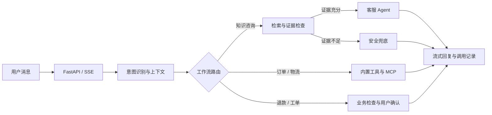

# EvanHelp

面向电商售后场景的 AI 客服 Agent。系统把意图识别、知识检索和业务工具调用编排成可追踪的工作流，支持商品与售后咨询、订单物流查询、退款流程和人工升级。

EvanHelp 是可本地运行和扩展的个人项目。语言模型、向量模型和重排模型通过环境变量配置；演示订单与业务 MCP 服务使用本地样例数据。

## 功能概览

- **流式客服对话**：FastAPI 提供聊天页面与 SSE 响应，保留多轮会话上下文。
- **受控的工作流与 Agent**：按意图进入知识问答、业务查询、售后流程或兜底路径；Agent 可组合内置工具与 MCP 工具。
- **知识问答与检索**：支持 Markdown 文档切块、向量化、关键词与向量混合召回、重排，以及基于证据的拒答。
- **订单与售后**：样例工具查询订单和物流；退款、工单等写入操作需要用户确认。
- **知识运营**：知识录入、低置信问题复核、答案回写和检索评估形成维护闭环。
- **可观测与分类**：Langfuse 调用追踪、成本与评估视图，以及可选的主题分类器服务。

## 项目展示

一次客服请求会经过明确的路由和工具边界：



可在首页体验这些场景：

| 输入示例 | 系统行为 |
| --- | --- |
| “订单 1001 的物流到哪了？” | 查询样例订单，再调用物流工具并展示调用轨迹。 |
| “这件商品过了七天还能退吗？” | 检索售后政策；证据不足时给出兜底答复，不凭空承诺。 |
| “帮我申请退款” | 核对订单和政策，展示确认步骤后再提交售后工单。 |
| “我要投诉” | 使用安抚与升级流程，提供转人工或创建工单的入口。 |

订单 `1001`、`2002` 和物流状态是本地演示数据；实际电商订单系统需要接入方提供 API 或 MCP 服务。主题分类器的留出集报告记录了 161 条样例上的 micro-F1 0.964（阈值 0.45）；这是项目内评估结果，详见 [`data/classifier/reports/eval_report.md`](data/classifier/reports/eval_report.md)。

## 快速开始

需要 Python 3.12+、[uv](https://docs.astral.sh/uv/)、Docker Compose，以及 `make` 和 Bash（Windows 可使用 WSL）。聊天模型、Embedding 和 Rerank 服务需要各自可用的 API 地址和密钥。

```bash
uv sync
cp .env.example .env
```

编辑 `.env`，填入 `CHAT_*`、`EMBED_API_KEY` 和 `RERANK_API_KEY`。模板给出硅基流动的配置示例，可按 OpenAI 兼容服务调整聊天模型地址与名称。不要把真实密钥提交到 Git。

```bash
docker compose up -d
make seed
make kb-build
make kb-vectorize
make dev
```

浏览器打开 <http://localhost:8000>。部署、初始化和停止服务的说明见 [`DEPLOY.md`](DEPLOY.md)；所有可用命令可用 `make help` 查看。

## 页面与接口

| 地址 | 功能 |
| --- | --- |
| `/` | 客服聊天与工具调用轨迹 |
| `/kb` | 导入和管理客服知识 |
| `/review` | 审核待补充的答案与知识缺口 |
| `/observability` | 运行追踪、评估和成本视图 |
| `/topics` | 客服问题主题分布 |
| `/acceptance` | 分类器评估与验收 |
| `/docs` | FastAPI OpenAPI 交互文档 |

应用默认使用 `8000` 端口；物流和售后 MCP 服务使用 `8101`、`8102`。部署架构和主要数据流见 [`docs/ARCHITECTURE.md`](docs/ARCHITECTURE.md)。

## 技术栈

Python 3.12 · FastAPI · LangGraph / LangChain · SQLAlchemy · MySQL · Milvus · MCP · Langfuse · pytest

## 仓库结构

```text
app/                 API、工作流、检索、工具、数据库模型与页面
mcp_servers/         本地物流与售后 MCP 服务
data/kb/             客服政策和商品资料样例
scripts/             启动、建库、评估与分类器运维脚本
sql/                 按序初始化的数据库结构和演示数据
app/static/           聊天与运营页面
tests/                单元测试及离线评估样例
```

## 开发与扩展

- 使用 `make test` 运行不依赖真实模型 API 的测试。
- `.env.example` 是唯一应提交的环境配置模板；本机 `.env`、数据库和运行日志已加入忽略规则。
- 新增业务能力时，可在 `app/tools/` 增加工具，或接入 MCP server；修改路由和状态图时关注 `app/graph/`。
- 系统集成边界、模块职责和数据流见 [`docs/ARCHITECTURE.md`](docs/ARCHITECTURE.md)。
